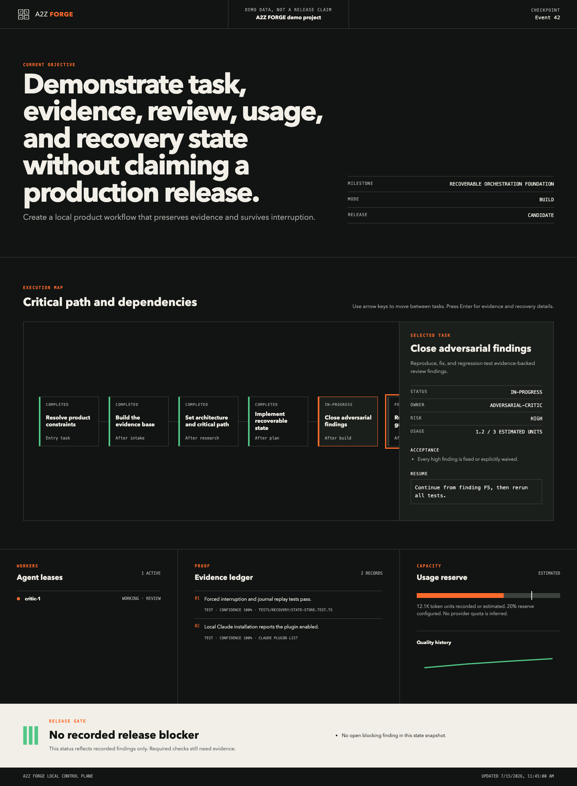
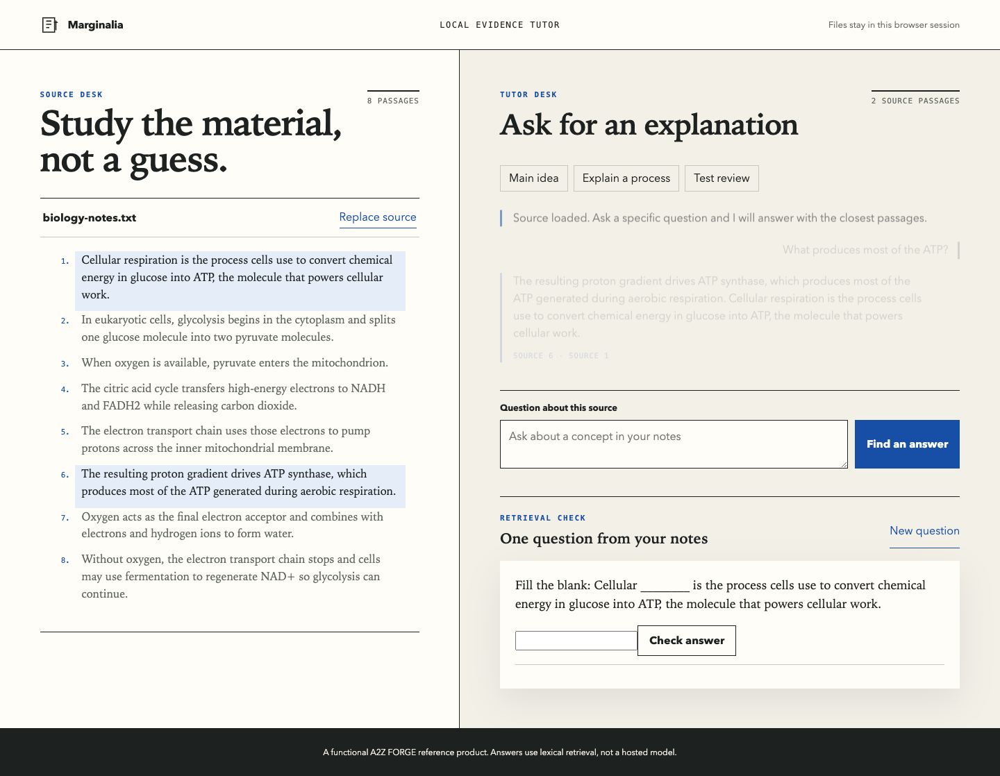

# A2Z FORGE

**Idea in. Production out.**

A2Z FORGE is an open-source autonomous product foundry for Claude Code and compatible coding agents. It turns one product prompt into a persistent, evidence-driven workflow for research, strategy, design, implementation, independent critique, testing, recovery, demonstration, and handoff.

It does not guarantee product-market fit, revenue, perfect output, or exact provider-limit avoidance. It does not treat simulated reviewers as customers or a passing build as proof of production readiness.

## 60-second demonstration

```bash
./installers/install.sh
mkdir my-product && cd my-product
forge init --idea "Build a focused tool that turns meeting notes into owned decisions"
forge status
```

Then restart Claude Code and run:

```text
/a2z-forge:forge Build a focused tool that turns meeting notes into owned decisions. Due 2026-08-01.
```

The first command creates a recoverable `.forge/` control plane with the goal, project brief, decisions, risks, evidence ledger, nine-stage task graph, agent state, journal, and exact resume instructions. The plugin continues from those artifacts rather than depending on chat history.

## What it does

- Validates the problem before expanding the solution.
- Discovers installed Agent Skills and loads only task-relevant instructions.
- Routes bounded work through provider-neutral agent adapters.
- Maintains atomic snapshots, an append-only journal, leases, checkpoints, and Git references.
- Models work as a dependency-validated task graph with a critical path and budget reserve.
- Requires source and confidence records for research claims and licenses for code reuse.
- Pairs significant artifacts with independent evidence-backed review.
- Blocks release on critical findings or required checks without evidence.
- Recovers coherent state after a torn write, terminal closure, or context reset.
- Produces truthful demos and a founder handoff from actual product artifacts.

## Install

```bash
git clone https://github.com/Jumpsy/a2z-forge.git
cd a2z-forge
./installers/install.sh
```

Requirements: Node.js 22 or newer, npm, Git, and Claude Code. See [installation](docs/INSTALLATION.md) for scopes and manual setup.

## First command

Claude Code officially namespaces plugin skills. Invoke:

```text
/a2z-forge:forge <idea, deadline, and optional constraints>
```

Use `/a2z-forge:forge-status` at any time. The portable CLI also exposes `forge init`, `forge status`, `forge checkpoint`, `forge recover`, and `forge doctor`.

## Architecture

```text
Claude plugin and portable Agent Skills
                  |
                  v
        provider-neutral orchestrator
          |        |        |
          v        v        v
     task DAG   scheduler  adapters
          \        |        /
           v       v       v
        atomic state + JSONL journal
                  |
                  v
       evidence and release gates
```

The TypeScript core owns state and policy. Agent-specific wrappers remain thin. Managed products keep durable control state inside `.forge/`; plugin cache directories are never used for product state. See [architecture](docs/ARCHITECTURE.md).

## Local control room

Run `npm run dashboard` to open the task graph, agent leases, evidence ledger, usage reserve, quality history, and release gate at `http://127.0.0.1:4180`. The bundled state is visibly marked as demo data; managed projects can replace `dashboard/project-state.json` with their current snapshot.



## Supported agents

| Runtime | Status | Notes |
| --- | --- | --- |
| Claude Code | Verified primary | Marketplace plugin, 19 skills, 25 specialized agents, lifecycle hooks |
| Codex | Adapter foundation | Portable Agent Skills and CLI adapter; native package remains under evaluation |
| OpenCode | Adapter foundation | CLI adapter and common task protocol |
| Antigravity | Adapter foundation | CLI adapter and common task protocol |
| Local processes and models | Supported foundation | Deterministic scripts and executable adapter; local-model quality routing is project-specific |

No adapter is marked production-complete without an integration test for start, status, result, stop, and resume.

## Permission model

- `observe`: inspect local and public sources without external mutation.
- `build`: modify authorized local files and run local tools.
- `connected-build`: use named authorized services within stated scope.
- `autopilot`: perform pre-authorized project actions within explicit boundaries.

Purchases, irreversible remote deletion, public publication, security-setting changes, contracts, and unrelated communication still require specific authorization. See [permissions](docs/PERMISSIONS.md).

## Example output

The included [Marginalia Study Tutor](examples/study-tutor) is a functional reference product. It loads local text, answers through lexical retrieval, cites exact passages, and generates a source-traceable review question. It deliberately uses no hosted model so the tested behavior remains reproducible.



[Watch the recorded reference workflow](docs/assets/video/reference-workflow.mp4)

Run it:

```bash
node examples/study-tutor/server.mjs
```

Browser evidence covers the empty state, source loading, cited answer, review feedback, desktop layout, mobile layout, overflow, and console errors.

## Verification

```bash
npm ci
npm run check
npm test
npm run build
npm run secret-scan
claude plugin validate . --strict
```

Current foundation: 23 automated tests plus Playwright journeys for the reference product and control room. The installer has been run locally and Claude Code reports the plugin enabled.

## Limitations

- Provider-specific usage totals are labeled estimated unless the provider reports them.
- CLI adapters do not normalize every vendor's streaming and token telemetry yet.
- The design tournament, video-understanding wrapper, deployment adapters, and large-scale reference evaluations remain active roadmap work.
- The public framework uses Claude's official namespaced command, not an unqualified `/forge` alias.
- A simulated quality council is critique input, not market validation.

## Roadmap

1. Finish live Claude task execution and provider telemetry adapters.
2. Add installed-skill trust review and video-understanding integration.
3. Connect live project snapshots to the completed local control room and expand the production-check matrix.
4. Add crash, low-budget, two-day deadline, broken-repository, AI product, design-heavy site, and small-game evaluations.
5. Publish signed releases and reproducible benchmark artifacts.

See [implementation plan](IMPLEMENTATION_PLAN.md), [environment report](docs/ENVIRONMENT_REPORT.md), [security policy](SECURITY.md), and [contributing](CONTRIBUTING.md).
